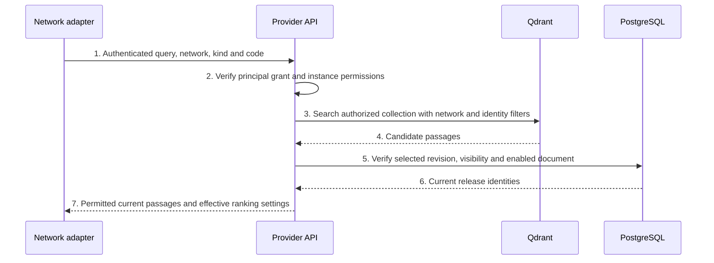

# Search contract and BV examples

## What changed

Search now accepts exact document kind and code filters. These filters run in Qdrant before candidate selection. They prevent a query about one scheme from returning another scheme just because the passages are similar. A code miss returns no matches. It never retries without the code.

The request is typed and bounded. Invalid controls return 422 before retrieval. Existing top-k, candidate count, per-document limits, language selection, applicability filters, hybrid ranking, and provenance remain available. The application returns its effective configuration with the results.

## Match the recorded BV query

The recorded BV tool call asked for `PM Kisan overview`, resolved scheme code `pk`, and requested ten results. Its returned Exclusion passage had a score of `0.8337`. Those are recorded production observations, not the expected score or ranking of the restored local corpus. The earlier local category-only comparison included Kisan Credit Card, while a workflow-specific query returned two passages because the default per-document cap was two.

Use this local operator request to restrict the same question to PM Kisan:

```json
{
  "query": "PM Kisan overview",
  "group": "bv",
  "document_kind": "scheme",
  "document_code": "pk",
  "search_mode": "TENSOR",
  "top_k": 10,
  "candidate_cap": 80,
  "max_chunks_per_doc": 10
}
```

`document_code` requires `document_kind`. A kind and code can match more than one document. Use `document_workflow_id` when the user has explicitly selected one document. Instance permission filters always apply. An exact PM Kisan request cannot return a Kisan Credit Card document. It may return fewer than ten results if fewer valid, permitted passages match.

`TENSOR` provides a dense-search comparison with the older BV retrieval. `HYBRID` ranks dense candidates using lexical and metadata signals in the application. It is not Qdrant sparse-vector hybrid retrieval. Results and scores can differ because the restored corpus, passage boundaries, embedding model, filters, and ranking differ. The BV provider's section expansion and domain ranking remain consumer behavior; this change does not claim that those algorithms are identical.

## Search an authorized network release

The network adapter authenticates to this API with its provisioned Keycloak principal. The API maps the verified subject to its permitted serving networks using `SEARCH_NETWORK_PRINCIPALS`. A plain network ID, a catalog service key, instance membership, a provider ID, or a local authentication bypass does not grant this permission. The adapter must still validate its inbound network participant and route before forwarding a request.

```json
{
  "query": "PM Kisan overview",
  "network_id": "oan.dev",
  "group": "bv",
  "document_kind": "scheme",
  "document_code": "pk",
  "search_mode": "TENSOR",
  "top_k": 10,
  "candidate_cap": 80,
  "max_chunks_per_doc": 10
}
```

The server resolves the target collection. An explicitly supplied collection must match that target. Network principals must provide a network ID and cannot fall back to local draft search. Unknown or ungranted networks return 403. Index-only deployments deny network search. Network requests cannot disable current validity or request raw diagnostic hits.



The same release check applies to the expanded candidate retry and scheme choices. Drafts, unmarked legacy points, withdrawn releases, and points belonging to a different network are excluded from network responses. The network-scoped catalog reads names, codes, aliases and passage counts from the selected frozen revision. A new draft does not replace those published values.

The current storage policy still uses separate release collections per network. Shared collection storage across networks and complete NxN adapter integration remain separate work. The request boundary and release checks introduced here are prerequisites, not a claim that that integration has shipped.

Local searches resolve an omitted collection to `VECTOR_DB_COLLECTION_NAME`. Explicit selectors must match the configured serving collection. PostgreSQL must prove successful ownership of each returned passage. New local indexing writes a frozen revision under its own key and activates that key only after all passages are written. Older saved numeric settings are clamped to the supported limits on read; new out-of-range settings are rejected.

## Controls and result interpretation

| Control | Accepted values or bounds | Meaning |
| --- | --- | --- |
| `query` | Text, 1 to 4,096 characters | User's retrieval question |
| `document_kind`, `document_code` | Optional strings, up to 256 characters | Exact, normalized identity filters |
| `top_k` | 1 to 50 | Maximum final results |
| `candidate_cap` | 1 to 200, raised to at least top-k | Candidate retrieval budget |
| `candidate_multiplier` | 1 to 100 | Candidate budget multiplier when an explicit cap is absent |
| `max_chunks_per_doc` | 1 to 50 | Final passage cap for one document; default comes from settings, normally two |
| `ef_search` | 1 to 10,000 | Dense search effort |
| `search_mode` | `TENSOR`, `LEXICAL`, `HYBRID` | Retrieval and ranking path |
| `hybrid_alpha` | 0 to 1 | Hybrid semantic weighting |
| `ranking_method` | `rrf`, `normalize_linear` | Hybrid score combination |
| `hybrid_rrf_k` | 1 to 1,000 | Reciprocal-rank offset |
| `rerank_mode` | `none`, `bm25lite`, `rrf-lite`, `heuristic` | Implemented second-pass ranking; no cross-encoder or ColBERT inference is claimed |
| `language`, `strict_language` | BCP 47 language tag and boolean | Localized output and optional exact available-language restriction |
| `applicability` | Categories, subject IDs, areas, seasons and tags | Shared metadata filters |
| `metadata_filters` | Document or chunk scope, category, crop, season and area | Reviewed metadata filters |
| `valid_on`, `include_expired` | Local operator inspection only | Historical or unbounded validity inspection |

`_score` retains the underlying retrieval score. `_hybrid_score` and `_rerank_score` describe application ranking when those paths are selected. `effective_config.ranking_score_field` identifies the final ordering field. These scores are not interchangeable probabilities. Neither recorded BV caller required a score threshold, so this change does not add one.

The API preserves existing response aliases for external consumers. Canonical payloads use localized labels, typed subjects, document identity, and effective chunk metadata. Extra subject attributes remain attached to the relevant subject. The adapter can construct citations from the document name, instance, section, pages or source spans, document/chunk identity, and released revision. The ingestion `source` label is not a human citation.

## Deployment and remaining cutover work

Configure named publication targets and an explicit principal grant before enabling network requests. The FastAPI `/openapi.json` is generated from `SearchRequest` and is the authoritative request schema. The standalone search YAML is a published snapshot that must be regenerated after contract changes.

The tests exercise exact identity and network filtering in the real in-process Qdrant engine, PostgreSQL release selection, endpoint authorization, malformed input, and canonical exports. They use deterministic vectors for correctness; they do not measure production semantic ranking. Live BAP replay, provisioning adapter grants, external model quality, citation parity, the BV catalog/Redis bridge, and the separate general-document and video callers remain cutover checks.
