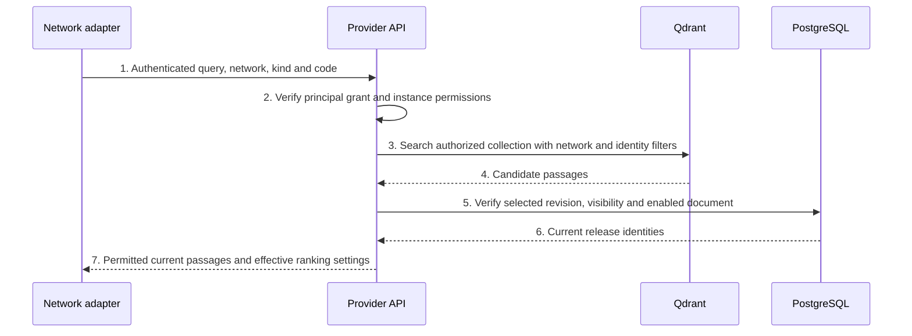

# Search contract and BV examples

## What changed

Search now accepts exact document kind and code filters. These filters run in Qdrant before candidate selection. They prevent a query about one scheme from returning another scheme just because the passages are similar. In the default profile a code miss returns no matches and never retries without the code. The `scheme` profile below widens instead.

## Scheme profile

`"search_profile": "scheme"` answers scheme questions the way the BV provider did (ported from `bharat-provider-backend` `scheme-query.util.ts`). It searches only scheme documents.

1. **Scheme resolution.** A `document_code` the live catalog knows is used as sent. Otherwise the question decides: the longest code, name or alias found in it wins. Aliases of six characters or fewer, and hyphenated ones, must stand alone as words. Generic words such as "scheme" or "yojana" never match. The catalog is the caller's visible live schemes, with the same derived aliases indexing uses.
2. **Unindexed scheme.** When nothing resolves but the question still names a topic after intent and generic words are removed, the response is empty with status `scheme_unavailable`, and no vector search runs. An unreadable catalog never triggers this.
3. **Question type.** English keyword rules classify the intent (`eligibility`, `application`, `support`) and the section focus (`eligibility_with_exclusion`, `exclusion_only`). The matching guideline vocabulary is appended to the embedding query.
4. **Widening.** When the resolved scheme has no visible passages, search runs again across all schemes and `widened_to_all_schemes` is true. Results without a single scheme are limited to catalogued schemes.
5. **Section types.** Every passage gets a `section_type` (`eligibility`, `exclusion`, `application`, `support`, `other`) classified from its text at query time, so existing points need no re-indexing. The heading-title `section` used for citations is unchanged.
6. **Supplemental search.** An eligibility question with no exclusion passage, or a support or application question with none of its section, searches once more with that section's vocabulary and merges new passages.
7. **Guideline re-ranking.** `_scheme_score` starts from the retrieval score, adds 0.1 per asked-intent keyword in the passage and a farmer-text score (capped at 0.4), then applies the intent's bonus and penalty: eligibility penalises institutional text and cost tables; application rewards how-to-apply phrases and numbered steps and penalises app-screen instructions; support rewards benefit words and welcomes tables only when the question asks about subsidy or amounts. Without an intent, institutional and table text are mildly penalised. The weights are those of the BV provider.
8. **Final order.** "Who cannot apply" puts exclusion passages first. Eligibility questions fill half of `top_k` with eligibility and half with exclusion passages, then the rest by score. Support and application questions put their section first. Duplicate chunks are dropped.
9. **Defaults.** `TENSOR` mode, `top_k` 10, `candidate_cap` max(8 × top_k, 40), and no per-document cap (`max_chunks_per_doc` is null, so section balancing sees every candidate). Explicit request values override them.

The response adds `scheme_search`: `resolved_scheme_code`, `scheme_code_source` (`request`, `query` or null), `effective_scheme_code`, `widened_to_all_schemes`, `query_intent`, `section_focus`, `supplemental_section`, `supplemental_hits`, `status` (`success`, `not_found`, `scheme_unavailable`) and `message`. It is null for the default profile. `effective_config.ranking_score_field` is `_scheme_score`; the final order also reflects the section slots above.

## Advisory profile

`"search_profile": "advisory"` searches only advisory documents the way the BV provider did (ported from `advisory-qdrant.util.ts`). An optional `advisory` object describes the farmer: `crop`, `season`, `days_after_sowing`, `state_lgd_code` and `district_lgd_code`.

1. **Crop filter.** The crop is the only hard filter. Known names and aliases, including Hindi (`gehun`, `गेहूं`, `dhan`, `jowar`), map to the stored crop; other names are title-cased.
2. **One passage per entry.** The best-scoring passage of each advisory entry (document and `pop_id`) is kept. Passages without an entry id are kept one per chunk.
3. **Soft boosts.** The preferred season adds 0.1 (`ADVISORY_DEFAULT_SEASON` overrides the request; multi-season entries such as "Rabi,Kharif" match either). A day count inside the entry's sowing window adds 0.15. A place match adds 0.2: the farmer's district is listed, or the farmer's state is covered statewide. When only a state is sent and the advisory lists districts of it, a partial match adds 0.1. Nothing is dropped. The result is `_advisory_score`.
4. **Defaults.** `TENSOR` mode, `top_k` 5 (`ADVISORY_QDRANT_TOP_K` overrides), `candidate_cap` 40, and no per-document cap.

Each hit adds `location_match` (`national`, `matched`, `state_partial`, `other`, `not_requested`) and `origin`. The response adds `advisory_search`: `status` (`success`, `not_found`), `message`, `crop`, `preferred_season`, `location_status` (`not_requested`, `location_matched`, `location_partial`, `location_not_applied`, `other_only`, `no_match`), `has_day_range`, `days_matched` and `has_location_specific`.

ICAR intake stores a supported crop sowing window as `attributes.applicability[].relativeTiming`, separately from calendar validity. Qdrant carries it under `metadata.attributes.applicability`. Search ranks one timing-only rule for the `Sowing` event, including a single valid bound. Other events and rules with additional qualifiers require a matching request context before they can affect ranking.

Older ICAR documents can still supply a sowing window through their passage text. The `advisory` payload also carries the POP record ID and LGD codes and names from coverage areas. A state is statewide only when the advisory lists no district, because the template does not record which state a district belongs to. The `source` payload shows the intake channel and is returned as `origin`.

The ICAR template does not keep the institute or creator, so the BV "Source: institute, creator" line is not available from this index.

The scheme keyword rules are English only, as in the source. "Who cannot apply" also counts toward the application intent because it contains "apply"; the exclusion focus still decides the final order.

The request is typed and bounded. Invalid controls return 422 before retrieval. Existing top-k, candidate count, per-document limits, language selection, applicability filters, hybrid ranking, and provenance remain available. The application returns its effective configuration with the results.

## Match the recorded BV query

The recorded BV tool call asked for `PM Kisan overview`, resolved scheme code `pk`, and requested ten results. Its returned Exclusion passage had a score of `0.8337`. Those are recorded production observations, not the expected score or ranking of the restored local corpus. The earlier local category-only comparison included Kisan Credit Card, while a workflow-specific query returned two passages because the default per-document cap was two.

Use this local operator request to restrict the same question to PM Kisan:

```json
{
  "query": "PM Kisan overview",
  "group": "bv",
  "document_kind": "scheme",
  "document_code": "pk",
  "search_mode": "TENSOR",
  "top_k": 10,
  "candidate_cap": 80,
  "max_chunks_per_doc": 10
}
```

`document_code` requires `document_kind`. A kind and code can match more than one document. Use `document_workflow_id` when the user has explicitly selected one document. Instance permission filters always apply. An exact PM Kisan request cannot return a Kisan Credit Card document. It may return fewer than ten results if fewer valid, permitted passages match.

`TENSOR` provides a dense-search comparison with the older BV retrieval. `HYBRID` ranks dense candidates using lexical and metadata signals in the application. It is not Qdrant sparse-vector hybrid retrieval. Results and scores can differ because the restored corpus, passage boundaries, embedding model, filters, and ranking differ. The BV provider's section expansion and domain ranking remain consumer behavior; this change does not claim that those algorithms are identical.

## Search an authorized network release

The network adapter authenticates to this API with its provisioned Keycloak principal. The API maps the verified subject to its permitted serving networks using `SEARCH_NETWORK_PRINCIPALS`. A plain network ID, a catalog service key, instance membership, a provider ID, or a local authentication bypass does not grant this permission. The adapter must still validate its inbound network participant and route before forwarding a request.

```json
{
  "query": "PM Kisan overview",
  "network_id": "oan.dev",
  "group": "bv",
  "document_kind": "scheme",
  "document_code": "pk",
  "search_mode": "TENSOR",
  "top_k": 10,
  "candidate_cap": 80,
  "max_chunks_per_doc": 10
}
```

The server resolves the target collection. An explicitly supplied collection must match that target. Network principals must provide a network ID and cannot fall back to local draft search. Unknown or ungranted networks return 403. Index-only deployments deny network search. Network requests cannot disable current validity or request raw diagnostic hits.



The same release check applies to the expanded candidate retry and scheme choices. Drafts, unmarked legacy points, withdrawn releases, and points belonging to a different network are excluded from network responses. The network-scoped catalog reads names, codes, aliases and passage counts from the selected frozen revision. A new draft does not replace those published values.

The current storage policy still uses separate release collections per network. Shared collection storage across networks and complete NxN adapter integration remain separate work. The request boundary and release checks introduced here are prerequisites, not a claim that that integration has shipped.

Local searches resolve an omitted collection to `VECTOR_DB_COLLECTION_NAME`. Explicit selectors must match the configured serving collection. PostgreSQL must prove successful ownership of each returned passage. New local indexing writes a frozen revision under its own key and activates that key only after all passages are written. Older saved numeric settings are clamped to the supported limits on read; new out-of-range settings are rejected.

## Controls and result interpretation

| Control | Accepted values or bounds | Meaning |
| --- | --- | --- |
| `query` | Text, 1 to 4,096 characters | User's retrieval question |
| `document_kind`, `document_code` | Optional strings, up to 256 characters | Exact, normalized identity filters |
| `top_k` | 1 to 50 | Maximum final results |
| `candidate_cap` | 1 to 200, raised to at least top-k | Candidate retrieval budget |
| `candidate_multiplier` | 1 to 100 | Candidate budget multiplier when an explicit cap is absent |
| `max_chunks_per_doc` | 1 to 50 | Final passage cap for one document; default comes from settings, normally two |
| `ef_search` | 1 to 10,000 | Dense search effort |
| `search_mode` | `TENSOR`, `LEXICAL`, `HYBRID` | Retrieval and ranking path |
| `hybrid_alpha` | 0 to 1 | Hybrid semantic weighting |
| `ranking_method` | `rrf`, `normalize_linear` | Hybrid score combination |
| `hybrid_rrf_k` | 1 to 1,000 | Reciprocal-rank offset |
| `rerank_mode` | `none`, `bm25lite`, `rrf-lite`, `heuristic` | Implemented second-pass ranking; no cross-encoder or ColBERT inference is claimed |
| `language`, `strict_language` | BCP 47 language tag and boolean | Localized output and optional exact available-language restriction |
| `applicability` | Categories, subject IDs, areas, seasons and tags | Shared metadata filters |
| `metadata_filters` | Document or chunk scope, category, crop, season and area | Reviewed metadata filters |
| `valid_on`, `include_expired` | Local operator inspection only | Historical or unbounded validity inspection |

`_score` retains the underlying retrieval score. `_hybrid_score` and `_rerank_score` describe application ranking when those paths are selected. `effective_config.ranking_score_field` identifies the final ordering field. These scores are not interchangeable probabilities. Neither recorded BV caller required a score threshold, so this change does not add one.

The API preserves existing response aliases for external consumers. Canonical payloads use localized labels, typed subjects, document identity, and effective chunk metadata. Extra subject attributes remain attached to the relevant subject. The adapter can construct citations from the document name, instance, section, pages or source spans, document/chunk identity, and released revision. The ingestion `source` label is not a human citation.

## Deployment and remaining cutover work

Configure named publication targets and an explicit principal grant before enabling network requests. The FastAPI `/openapi.json` is generated from `SearchRequest` and is the authoritative request schema. The standalone search YAML is a published snapshot that must be regenerated after contract changes.

The tests exercise exact identity and network filtering in the real in-process Qdrant engine, PostgreSQL release selection, endpoint authorization, malformed input, and canonical exports. They use deterministic vectors for correctness; they do not measure production semantic ranking. Live BAP replay, provisioning adapter grants, external model quality, citation parity, the BV catalog/Redis bridge, and the separate general-document and video callers remain cutover checks.
